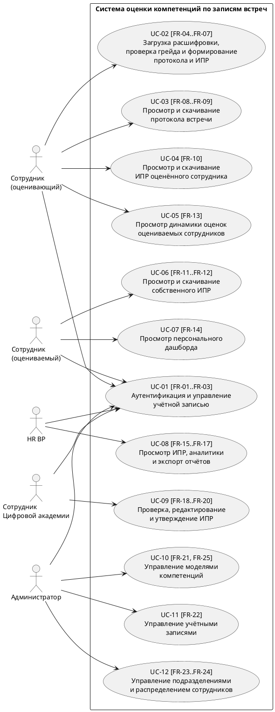

# Лабораторная работа №1. Формулирование требований к программной системе

| Поле | Значение |
|---|---|
| **Студент** | Чернышова Екатерина Николаевна |
| **Группа** | РИС23-2 |
| **Вариант** | Система оценки компетенций по записям встреч |
| **Постановка задачи** | Техническое задание «Система оценки компетенций по записям встреч» |
| **Репозиторий** |  |
| **Дата сдачи** | 15.11.2026 |

**Тема:** Анализ предметной области и формулирование требований к программной системе.

**Цель работы:** Научиться анализировать поставленную задачу, выделять заинтересованных лиц, формулировать функциональные и нефункциональные требования, представлять результаты в виде диаграммы вариантов использования.

---

## Краткое описание системы

Разрабатываемая система предназначена для автоматизированной оценки компетенций сотрудников на основе текстовых расшифровок онлайн-встреч, полученных из системы ДИОН. Система анализирует содержание встречи в соответствии с моделью компетенций должности и формирует протокол встречи, отражающий основные договорённости, сильные стороны и зоны развития сотрудника, а также индивидуальный план развития (ИПР). Руководители могут просматривать результаты проведённых оценок, а сотрудники — свои ИПР и динамику развития компетенций. HR BP получают сводную аналитику по своему подразделению, сотрудники Цифровой академии проверяют и утверждают ИПР, а администраторы управляют пользователями, подразделениями и моделями компетенций.

---

## Оглавление

1. [Стейкхолдеры](#1-перечень-заинтересованных-лиц-стейкхолдеров)
2. [Функциональные требования](#2-перечень-функциональных-требований)
3. [Диаграмма вариантов использования](#3-диаграмма-вариантов-использования)
4. [Предположения](#4-перечень-сделанных-предположений)
5. [Нефункциональные требования](#5-перечень-нефункциональных-требований)
6. [Чек-лист самопроверки](#6-чек-лист-самопроверки)

---

## 1. Перечень заинтересованных лиц (стейкхолдеров)

В проекте выделено шесть основных заинтересованных лиц. К внутренним пользователям системы относятся сотрудники, HR BP, сотрудники Цифровой академии и администраторы. Заказчик определяет бизнес-цели и ожидаемый результат разработки.

| ID | Стейкхолдер | Роль | Интересы / цели | Влияние |
|----|-------------|------|-----------------|---------|
| SH-01 | Сотрудник (оценивающий) | Загружает расшифровки встреч, инициирует оценку коллег с более низким грейдом, просматривает протоколы и ИПР, отслеживает динамику оценок | Сократить время подготовки результатов оценки, получить структурированный протокол и ИПР, отслеживать развитие оцениваемых сотрудников | высокое |
| SH-02 | Сотрудник (оцениваемый) | Просматривает собственный ИПР и персональную динамику оценок | Понимать свои сильные стороны и зоны роста, отслеживать цели развития, получать доступ к собственным результатам без доступа к протоколам оценки | высокое |
| SH-03 | HR BP | Анализирует ИПР и сводную статистику сотрудников своего подразделения, экспортирует отчёты | Оценивать эффективность развития персонала, выявлять проблемные зоны, планировать бюджет на обучение | высокое |
| SH-04 | Сотрудник Цифровой академии | Проверяет протоколы и сгенерированные ИПР, редактирует и утверждает планы развития | Обеспечивать качество ИПР и соответствие планов стандартам развития сотрудников | высокое |
| SH-05 | Администратор | Управляет учётными записями, моделями компетенций, должностями и подразделениями | Поддерживать актуальность данных, организационной структуры и прав доступа | высокое |
| SH-06 | Заказчик — старший менеджер по оценке потенциала сотрудников | Определяет цели и ожидаемые результаты проекта, заинтересован в результатах внедрения | Повысить объективность оценки компетенций, оптимизировать обучение и получить централизованную аналитику | высокое |

**Примечание:** роли «Сотрудник (оценивающий)» и «Сотрудник (оцениваемый)» представляют разные варианты использования системы одним типом пользователя. Их разделение необходимо для отражения различий в правах доступа.

---

## 2. Перечень функциональных требований

На основании технического задания сформулированы функциональные требования, охватывающие основные пользовательские сценарии всех ролей системы. Требованиям назначены приоритеты по методологии MoSCoW: Must — обязательная функциональность, Should — важная функциональность, которую желательно реализовать, Could — дополнительная функциональность, реализация которой возможна при наличии ресурсов. В таблице приведены основные требования, необходимые для реализации ключевых бизнес-процессов.

| ID | Требование | Стейкхолдер | Приоритет (MoSCoW) | Обоснование |
|----|------------|-------------|---------------------|-------------|
| FR-01 | Система должна обеспечивать аутентификацию пользователей по логину и паролю | Все роли | Must | Необходимо для идентификации пользователей и предотвращения доступа посторонних лиц к системе |
| FR-02 | Система должна предоставлять пользователям доступ к функциям в соответствии с назначенной ролью | Все роли | Must | Необходимо для разграничения функциональных возможностей и данных в зависимости от роли пользователя |
| FR-03 | Система должна предоставлять пользователям возможность изменить пароль своей учётной записи | Все роли | Should | Позволяет пользователям самостоятельно поддерживать безопасность своих учётных записей |
| FR-04 | Система должна предоставлять пользователям возможность просматривать информацию о своей учётной записи | Все роли | Should | Позволяет пользователям контролировать актуальность информации, связанной с их учётными записями |
| FR-05 | Система должна обеспечивать завершение текущей пользовательской сессии | Все роли | Should | Необходимо для защиты персональных данных при использовании общих или чужих устройств |
| FR-06 | Система должна проверять, что грейд оценивающего сотрудника выше грейда оцениваемого сотрудника перед началом обработки расшифровки встречи | SH-01, SH-02 | Must | Обеспечивает соблюдение установленного правила, согласно которому оценивать сотрудника может только сотрудник с более высоким грейдом |
| FR-07 | Пользователь с ролью «Сотрудник» в качестве оценивающего может загружать текстовую расшифровку встречи из Dion | SH-01 | Must | Загрузка текстовой расшифровки позволяет передать системе содержание встречи для последующего формирования протокола и ИПР |
| FR-08 | Пользователь с ролью «Сотрудник» в качестве оценивающего может указывать ссылку на встречу в Dion | SH-01 | Must | Протокол фиксирует краткое содержание встречи с указанием сильных и слабых сторон |
| FR-08 | Система должна формировать протокол встречи на основании загруженной текстовой расшифровки | SH-01 | Must | Предоставление ссылки на встречу является альтернативным способом передачи данных для последующего формирования протокола и ИПР |
| FR-09 | Система должна формировать индивидуальный план развития сотрудника на основании результатов оценки по модели компетенций | SH-01, SH-02 | Must | ИПР содержит цели и рекомендации по развитию компетенций сотрудника на основании проведённой оценки |
| FR-10 | Пользователь с ролью «Сотрудник» в качестве оценивающего может просматривать протоколы встреч, загруженные им ранее | SH-01 | Must | Позволяет сотруднику возвращаться к результатам ранее проведённых встреч и контролировать содержание обсуждений |
| FR-11 | Пользователь с ролью «Сотрудник» в качестве оценивающего может скачивать протокол встречи в формате PDF | SH-01 | Should | Позволяет сохранить протокол встречи в удобном для просмотра и передачи виде |
| FR-12 | Пользователь с ролью «Сотрудник» в качестве оценивающего может скачивать протокол встречи в формате Word | SH-01 | Must | Позволяет сохранять, редактировать и при необходимости дополнять протокол встречи для отчётности или передачи в архив |
| FR-13 | Пользователь с ролью «Сотрудник» в качестве оценивающего может просматривать ИПР сотрудника, которого он оценивал | SH-01 | Must | Позволяет оценивающему сотруднику ознакомиться с рекомендациями и целями развития сотрудника, которого он оценивал |
| FR-14 | Пользователь с ролью «Сотрудник» в качестве оценивающего может скачивать ИПР оценённого им сотрудника в формате PDF | SH-01 | Must | Позволяет сохранить ИПР для передачи сотруднику или использования в дальнейшей работе |
| FR-15 | Пользователь с ролью «Сотрудник» в качестве оценивающего может скачивать ИПР оценённого им сотрудника в формате Word | SH-01 | Should | Позволяет редактировать и дополнять ИПР при необходимости перед его передачей сотруднику |
| FR-16 | Пользователь с ролью «Сотрудник» в качестве оценивающего может просматривать динамику оценок по компетенциям сотрудников, с которыми проводил встречи, при наличии результатов минимум за три встречи | SH-01 | Should | Позволяет сотруднику анализировать результаты оценки разных сотрудников и отслеживать изменения их компетенций во времени |
| FR-17 | Пользователь с ролью «Сотрудник» в качестве оценивающего может выбирать сотрудника для просмотра динамики его оценок | SH-01 | Should | Необходимо для выбора конкретного сотрудника, результаты оценки которого требуется проанализировать |
| FR-18 | Пользователь с ролью «Сотрудник» в качестве оцениваемого может просматривать свой индивидуальный план развития (ИПР) | SH-02 | Must | Позволяет сотруднику ознакомиться со своими целями и задачами развития и отслеживать их выполнение |
| FR-19 | Пользователь с ролью «Сотрудник» в качестве оцениваемого может скачивать свой ИПР в формате PDF | SH-02 | Should | Позволяет сохранить индивидуальный план развития в удобном для просмотра виде и использовать его для самоконтроля |
| FR-20 | Пользователь с ролью «Сотрудник» в качестве оцениваемого может скачивать свой ИПР в формате Word | SH-02 | Should | Позволяет сохранить и при необходимости редактировать индивидуальный план развития для самоконтроля |
| FR-21 | Система должна ограничивать доступ пользователя с ролью «Сотрудник» в качестве оцениваемого к протоколам встреч, в которых он выступал оцениваемым | SH-02 | Must | Обеспечивает конфиденциальность процесса оценки и предотвращает доступ сотрудника к содержанию протоколов встреч |
| FR-22 | Пользователь с ролью «Сотрудник» в качестве оцениваемого может просматривать персональный дашборд с динамикой изменения оценок по компетенциям между последними встречами при наличии данных минимум за три встречи | SH-02 | Should | Позволяет сотруднику отслеживать собственный прогресс и изменения уровня развития компетенций на основании результатов нескольких встреч |
| FR-23 | Пользователь с ролью «HR BP» может просматривать ИПР сотрудников своего подразделения | SH-03 | Must | Позволяет HR BP оценивать общую эффективность программы развития и контролировать развитие персонала подразделения |
| FR-24 | Пользователь с ролью «HR BP» может просматривать сводную статистику и аналитический дашборд по сотрудникам своего подразделения | SH-03 | Must | Позволяет оперативно оценивать эффективность процессов развития и выявлять проблемные зоны |
| FR-25 | Пользователь с ролью «HR BP» может экспортировать отчёты по развитию персонала на основе данных ИПР в формате PDF | SH-03 | Should | Позволяет сохранять аналитические отчёты в удобном для просмотра и передачи виде для подготовки материалов руководству и планирования бюджета на обучение |
| FR-26 | Пользователь с ролью «HR BP» может экспортировать отчёты по развитию персонала на основе данных ИПР в формате Word | SH-03 | Should | Позволяет редактировать и дополнять отчёты для подготовки детализированной аналитики руководству и планирования бюджета на обучение |
| FR-27 | Пользователь с ролью «Администратор» может загружать новые модели компетенций в систему | SH-05 | Must | Позволяет обновлять критерии оценки персонала в соответствии с актуальными требованиями компании |
| FR-28 | Пользователь с ролью «Администратор» может редактировать существующие модели компетенций | SH-05 | Must | Позволяет адаптировать модели компетенций под меняющиеся бизнес-задачи |
| FR-29 | Пользователь с ролью «Администратор» может архивировать устаревшие модели компетенций | SH-05 | Must | Позволяет исключить устаревшие модели из использования при создании новых ИПР, сохраняя их в истории для аудита |
| FR-30 | Пользователь с ролью «Администратор» может создавать учётные записи пользователей | SH-05 | Must | Позволяет добавлять сотрудников в систему и предоставлять им доступ к необходимым функциям |
| FR-31 | Пользователь с ролью «Администратор» может редактировать учётные записи пользователей | SH-05 | Must | Позволяет поддерживать актуальность информации о сотрудниках в системе |
| FR-32 | Пользователь с ролью «Администратор» может архивировать учётные записи пользователей | SH-05 | Must | Позволяет поддерживать актуальность прав доступа и ограничивать доступ неактивных сотрудников |
| FR-33 | Пользователь с ролью «Администратор» может создавать учётные записи администраторов | SH-05 | Must | Позволяет добавлять новых администраторов в систему и предоставлять им необходимые права доступа |
| FR-34 | Пользователь с ролью «Администратор» может редактировать учётные записи администраторов | SH-05 | Must | Позволяет поддерживать актуальность информации об администраторах системы |
| FR-35 | Пользователь с ролью «Администратор» может архивировать учётные записи администраторов | SH-05 | Must | Позволяет поддерживать актуальность прав доступа администраторов |
| FR-36 | Пользователь с ролью «Администратор» может создавать новые подразделения в системе | SH-05 | Must | Позволяет формировать актуальную организационную структуру компании |
| FR-37 | Пользователь с ролью «Администратор» может редактировать существующие подразделения, включая изменение их названия и ответственных лиц | SH-05 | Must | Позволяет адаптировать организационную структуру под изменения в бизнесе |
| FR-38 | Пользователь с ролью «Администратор» может архивировать устаревшие или ликвидированные подразделения | SH-05 | Must | Позволяет исключать неактуальные подразделения из активных списков при назначении HR BP, сохраняя информацию о них в истории для аудита |
| FR-39 | Пользователь с ролью «Администратор» может добавлять сотрудников в конкретные подразделения | SH-05 | Must | Позволяет корректно распределять права доступа и назначать ответственных HR BP |
| FR-40 | Пользователь с ролью «Администратор» может архивировать принадлежность сотрудников к подразделениям при переводе или увольнении | SH-05 | Must | Позволяет поддерживать актуальность состава подразделений и сохранять историю принадлежности сотрудников к ним |
| FR-41 | Пользователь с ролью «Сотрудник Цифровой академии» может просматривать список сгенерированных ИПР, находящихся на стадии проверки | SH-04 | Must | Позволяет организовать процесс проверки сгенерированных индивидуальных планов развития |
| FR-42 | Пользователь с ролью «Сотрудник Цифровой академии» может просматривать протокол встречи для проверки корректности сгенерированного ИПР перед его утверждением | SH-04 | Must | Позволяет проверить соответствие содержания ИПР результатам встречи и обеспечить корректность плана развития |
| FR-43 | Пользователь с ролью «Сотрудник Цифровой академии» может редактировать текст ИПР при его несоответствии стандартам | SH-04 | Must | Позволяет корректировать содержание индивидуальных планов развития и обеспечивать их соответствие установленным стандартам |
| FR-44 | Пользователь с ролью «Сотрудник Цифровой академии» может утверждать ИПР с переводом его в статус «Готов к публикации» | SH-04 | Must | Обеспечивает завершение проверки и подтверждение готовности ИПР к публикации |
| FR-45 | Пользователь с ролью «Сотрудник Цифровой академии» может просматривать динамику изменения оценок по компетенциям подчинённых ему сотрудников, с которыми проводились встречи, при наличии данных минимум за три последние встречи | SH-04 | Should | Позволяет отслеживать изменения уровня компетенций сотрудников и визуализировать прогресс их развития от одной встречи к другой |

---

## 3. Диаграмма вариантов использования

Для представления функциональности системы и взаимодействия пользователей с ней используется диаграмма вариантов использования (Use Case Diagram), подготовленная на языке PlantUML. На диаграмме отражены основные акторы и доступные им действия. Каждому варианту использования присвоен идентификатор UC, а в его названии указаны связанные функциональные требования FR.

**Связь с требованиями:** ID соответствующего FR указан в названии Use Case. Диаграмма отражает основные сценарии работы сотрудника, оцениваемого сотрудника, HR BP, сотрудника Цифровой академии и администратора.

### Диаграмма

### Описание ключевого сценария

| Поле | Значение |
|---|---|
| **Use Case** | UC-02 [FR-04, FR-05, FR-06, FR-07] Загрузка расшифровки встречи и формирование результатов оценки |
| **Актор** | Сотрудник (оценивающий) |
| **Предусловие** | Пользователь авторизован в системе. Грейд оценивающего сотрудника выше грейда сотрудника, которого необходимо оценить. Подготовлена текстовая расшифровка встречи из ДИОН. |
| **Основной поток** | 1. Сотрудник открывает раздел оценки. → 2. Загружает текстовый файл с расшифровкой встречи. → 3. Указывает электронную почту оцениваемого сотрудника. → 4. Нажимает кнопку «Получить результат». → 5. Система проверяет грейды обоих сотрудников. → 6. Система анализирует расшифровку и формирует протокол встречи и ИПР. → 7. Сотрудник получает сформированные результаты. |
| **Постусловие** | Система сформировала протокол встречи и ИПР, которые доступны оценивающему сотруднику для просмотра. |
| **Альтернативный поток** | Если грейд оцениваемого сотрудника равен или выше грейда оценивающего, система не формирует результаты и выводит сообщение о том, что сотрудник может оценивать только сотрудников с более низким грейдом. |

---

## 4. Перечень нефункциональных требований

Нефункциональные требования сформулированы на основании технического задания и охватывают производительность, надёжность, безопасность, масштабируемость, мобильность и удобство использования. Для каждого требования указан измеримый критерий, позволяющий проверить его выполнение при тестировании. Требования, связанные с защитой персональных и конфиденциальных данных, имеют особое значение, поскольку система обрабатывает результаты оценки сотрудников и содержание рабочих встреч.

| ID | Категория | Требование | Метрика / критерий приёмки | Почему выбрано |
|----|-----------|------------|----------------------------|----------------|
| NFR-01 | Performance | Система должна обеспечивать быстрое выполнение пользовательских запросов | Время отклика не более 3 секунд | Необходимо для комфортной работы пользователей |
| NFR-02 | Performance | Система должна поддерживать одновременную работу нескольких пользователей | Не менее 50 одновременных запросов без нарушения функциональности | Системой могут одновременно пользоваться сотрудники разных подразделений |
| NFR-03 | Performance | Основная страница системы должна загружаться за ограниченное время | Полная загрузка основной страницы не более 5 секунд | Влияет на удобство использования системы |
| NFR-04 | Reliability / Availability | Система должна обеспечивать стабильную работу | Доступность не менее 99% времени в месяц | Необходимо для постоянного доступа к результатам оценки и ИПР |
| NFR-05 | Reliability | Количество критических сбоев должно быть ограничено | Не более 1 критического сбоя на 100 часов непрерывной работы | Позволяет снизить риск потери доступности ключевых функций |
| NFR-06 | Recoverability | Система должна восстанавливаться после критического сбоя | Среднее время восстановления не более 30 минут | Необходимо для сокращения времени простоя |
| NFR-07 | Security | Система должна быть защищена от распространённых веб-атак, включая SQL-инъекции | При тестировании не должно выявляться успешных SQL-инъекций | Система хранит персональные данные и результаты оценки сотрудников |
| NFR-08 | Security / Compliance | Обработка персональных данных должна соответствовать Федеральному закону №152-ФЗ | Проверка соответствия процессов обработки персональных данных требованиям 152-ФЗ | Необходимо для соблюдения законодательства |
| NFR-09 | Security | Для аутентификации и авторизации должны использоваться JWT-токены по стандарту RFC 7519 | Проверка корректности формирования и проверки JWT | Необходимо для безопасной идентификации пользователей |
| NFR-10 | Security | Access Token должен иметь ограниченный срок действия, а Refresh Token должен использоваться для продления сессии | Access Token — 15 минут; Refresh Token — 48 часов | Снижает риск использования скомпрометированных токенов |
| NFR-11 | Security | Refresh Token должен храниться в защищённой cookie с атрибутами HttpOnly, Secure и SameSite=Strict | Проверка наличия всех трёх атрибутов и невозможности доступа к токену через JavaScript | Снижает риск кражи токена и CSRF-атак |
| NFR-12 | Security | Передача токенов и защищаемых данных должна выполняться по HTTPS | Использование TLS 1.2 или TLS 1.3; передача по незашифрованному каналу запрещена | Необходимо для защиты данных при передаче |
| NFR-13 | Security / Confidentiality | Система должна исключать попадание конфиденциальной информации в итоговые протоколы и ИПР | При проверке тестовых расшифровок персональные данные, коммерческая и банковская тайна и инсайдерская информация отсутствуют в итоговых документах | Встречи могут содержать сведения ограниченного доступа |
| NFR-14 | Scalability | Архитектура системы должна поддерживать горизонтальное масштабирование | Возможность добавления экземпляров приложения без существенной переработки кода | Необходимо при увеличении числа пользователей и объёма данных |
| NFR-15 | Scalability | Сессии и кэш должны храниться во внешнем хранилище Redis | Состояние пользовательской сессии сохраняется и доступно при работе нескольких экземпляров приложения | Необходимо для корректной работы при горизонтальном масштабировании |
| NFR-16 | Compatibility / Mobility | Веб-приложение должно корректно работать на мобильных устройствах | Сохранение базовой функциональности на смартфонах и планшетах с различными разрешениями экранов | Пользователи могут обращаться к системе с мобильных устройств |
| NFR-17 | Usability | Основные пользовательские действия должны выполняться за небольшое количество шагов | Не более 3 шагов (кликов) до целевого действия согласно критерию приёмки ТЗ | Позволяет упростить взаимодействие с системой |

---

## 5. Перечень сделанных предположений (повышенная сложность)

При анализе технического задания были выделены моменты, которые требуют уточнения или дополнительной детализации для однозначной реализации системы. Ниже приведены предположения, принятые при формировании требований. Они не заменяют положения технического задания и должны быть согласованы с заказчиком при необходимости.

| ID | Предположение | Влияние на требования |
|----|---------------|-----------------------|
| A-01 | Под пользователем, загружающим расшифровку, понимается автор оценки — сотрудник с более высоким грейдом, чем у оцениваемого | Для FR-04 и FR-05 необходимо идентифицировать обоих сотрудников и сравнить их грейды до начала формирования результатов |
| A-02 | Текстовая расшифровка встречи загружается пользователем в виде файла; автоматическое получение расшифровки напрямую из ДИОН не предполагается, поскольку в ТЗ описана загрузка текстового файла | FR-04 предусматривает загрузку подготовленного файла. Интеграция с ДИОН напрямую требует отдельного уточнения |
| A-03 | Для построения динамики оценок система должна хранить результаты нескольких встреч одного сотрудника и связывать их с датами проведения встреч | Для FR-13, FR-14 и FR-20 требуется хранение истории оценок; отображение динамики возможно при наличии минимум трёх встреч |
| A-04 | Если у сотрудника нет результатов минимум по трём встречам, система не строит график динамики и показывает соответствующее информационное сообщение | Уточняет поведение системы для FR-13, FR-14 и FR-20 |
| A-05 | Роль «Сотрудник» может выступать как в качестве оценивающего, так и в качестве оцениваемого; доступные функции определяются не только ролью, но и связью пользователя с конкретной оценкой | Для FR-08, FR-10, FR-11 и FR-12 необходимо проверять права на конкретные данные, а не только тип роли |
| A-06 | HR BP имеет доступ только к данным сотрудников подразделения, за которое он отвечает | Для FR-15–FR-17 необходимо ограничивать выборку данных подразделением, закреплённым за HR BP |
| A-07 | Сотрудник Цифровой академии может утверждать ИПР только после проверки и, при необходимости, редактирования его содержания | Для FR-18 и FR-19 предполагается наличие статуса проверки и статуса «Готов к публикации» |
| A-08 | Архивирование пользователей, моделей компетенций и подразделений не означает физическое удаление записей из системы | Для FR-21–FR-25 необходимо сохранять историю и исключать архивные объекты из обычных списков выбора |
| A-09 | Сформированные протоколы и ИПР должны проходить проверку на наличие конфиденциальной информации до предоставления пользователям | Для NFR-13 и FR-06–FR-07 необходимо предусмотреть контроль содержания итоговых документов |
| A-10 | Форматы PDF и Word являются обязательными форматами экспорта документов, указанные в ТЗ | Для FR-09, FR-10, FR-11 и FR-17 необходимо обеспечить формирование и скачивание документов в обоих форматах |

---

