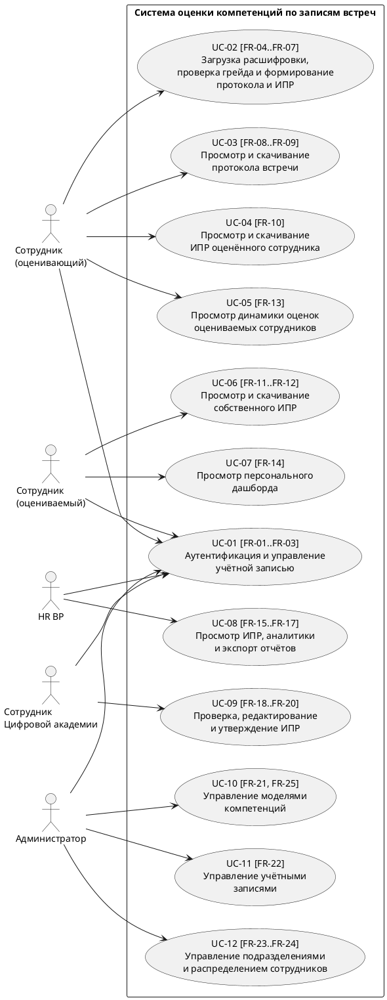

# Лабораторная работа №1. Формулирование требований к программной системе

| Поле | Значение |
|---|---|
| **Студент** | Чернышова Екатерина Николаевна |
| **Группа** | РИС23-2 |
| **Вариант** | Система оценки компетенций по записям встреч |
| **Постановка задачи** | Техническое задание «Система оценки компетенций по записям встреч» |
| **Репозиторий** |  |
| **Дата сдачи** | 15.11.2026 |

**Тема:** Анализ предметной области и формулирование требований к программной системе.

**Цель работы:** Научиться анализировать поставленную задачу, выделять заинтересованных лиц, формулировать функциональные и нефункциональные требования, представлять результаты в виде диаграммы вариантов использования.

---

## Краткое описание системы

Разрабатываемая система предназначена для автоматизированной оценки компетенций сотрудников на основе текстовых расшифровок онлайн-встреч, полученных из системы ДИОН. Система анализирует содержание встречи в соответствии с моделью компетенций должности и формирует протокол встречи, отражающий основные договорённости, сильные стороны и зоны развития сотрудника, а также индивидуальный план развития (ИПР). Руководители могут просматривать результаты проведённых оценок, а сотрудники — свои ИПР и динамику развития компетенций. HR BP получают сводную аналитику по своему подразделению, сотрудники Цифровой академии проверяют и утверждают ИПР, а администраторы управляют пользователями, подразделениями и моделями компетенций.

---

## Оглавление

1. [Стейкхолдеры](#1-перечень-заинтересованных-лиц-стейкхолдеров)
2. [Функциональные требования](#2-перечень-функциональных-требований)
3. [Диаграмма вариантов использования](#3-диаграмма-вариантов-использования)
4. [Предположения](#4-перечень-сделанных-предположений)
5. [Нефункциональные требования](#5-перечень-нефункциональных-требований)
6. [Чек-лист самопроверки](#6-чек-лист-самопроверки)

---

## 1. Перечень заинтересованных лиц (стейкхолдеров)

В проекте выделено шесть основных заинтересованных лиц. К внутренним пользователям системы относятся сотрудники, HR BP, сотрудники Цифровой академии и администраторы. Заказчик определяет бизнес-цели и ожидаемый результат разработки.

| ID | Стейкхолдер | Роль | Интересы / цели | Влияние |
|----|-------------|------|-----------------|---------|
| SH-01 | Сотрудник (оценивающий) | Загружает расшифровки встреч, инициирует оценку коллег с более низким грейдом, просматривает протоколы и ИПР, отслеживает динамику оценок | Сократить время подготовки результатов оценки, получить структурированный протокол и ИПР, отслеживать развитие оцениваемых сотрудников | высокое |
| SH-02 | Сотрудник (оцениваемый) | Просматривает собственный ИПР и персональную динамику оценок | Понимать свои сильные стороны и зоны роста, отслеживать цели развития, получать доступ к собственным результатам без доступа к протоколам оценки | высокое |
| SH-03 | HR BP | Анализирует ИПР и сводную статистику сотрудников своего подразделения, экспортирует отчёты | Оценивать эффективность развития персонала, выявлять проблемные зоны, планировать бюджет на обучение | высокое |
| SH-04 | Сотрудник Цифровой академии | Проверяет протоколы и сгенерированные ИПР, редактирует и утверждает планы развития | Обеспечивать качество ИПР и соответствие планов стандартам развития сотрудников | высокое |
| SH-05 | Администратор | Управляет учётными записями, моделями компетенций, должностями и подразделениями | Поддерживать актуальность данных, организационной структуры и прав доступа | высокое |
| SH-06 | Заказчик — старший менеджер по оценке потенциала сотрудников | Определяет цели и ожидаемые результаты проекта, заинтересован в результатах внедрения | Повысить объективность оценки компетенций, оптимизировать обучение и получить централизованную аналитику | высокое |

**Примечание:** роли «Сотрудник (оценивающий)» и «Сотрудник (оцениваемый)» представляют разные варианты использования системы одним типом пользователя. Их разделение необходимо для отражения различий в правах доступа.

---

## 2. Перечень функциональных требований

На основании технического задания сформулированы функциональные требования, охватывающие основные пользовательские сценарии всех ролей системы. Требованиям назначены приоритеты по методологии MoSCoW: Must — обязательная функциональность, Should — важная функциональность, которую желательно реализовать, Could — дополнительная функциональность, реализация которой возможна при наличии ресурсов. В таблице приведены основные требования, необходимые для реализации ключевых бизнес-процессов.

| ID | Требование | Стейкхолдер | Приоритет (MoSCoW) | Обоснование |
|----|------------|-------------|---------------------|-------------|
| FR-01 | Система должна обеспечивать аутентификацию пользователя по логину и паролю и предоставлять функции в соответствии с его ролью | SH-01, SH-02, SH-03, SH-04, SH-05 | Must | Необходимо для идентификации пользователей и разграничения доступа |
| FR-02 | Система должна предоставлять пользователю возможность просматривать информацию о своей учётной записи и изменять пароль | SH-01, SH-02, SH-03, SH-04, SH-05 | Should | Позволяет поддерживать актуальность данных и управлять учётной записью |
| FR-03 | Система должна предоставлять пользователю возможность завершить текущую сессию и выйти из системы на всех устройствах | SH-01, SH-02, SH-03, SH-04, SH-05 | Should | Необходимо для защиты учётной записи при использовании общих устройств |
| FR-04 | Система должна позволять оценивающему сотруднику загружать текстовую расшифровку онлайн-встречи из ДИОН для формирования протокола и ИПР | SH-01 | Must | Основной бизнес-процесс системы начинается с загрузки расшифровки |
| FR-05 | Система должна проверять, что грейд оценивающего сотрудника выше грейда оцениваемого, и разрешать формирование результатов только при выполнении этого условия | SH-01, SH-02 | Must | Ограничение необходимо для соблюдения правил оценки сотрудников |
| FR-06 | Система должна формировать протокол встречи на основании загруженной расшифровки | SH-01 | Must | Протокол фиксирует содержание встречи, договорённости, сильные стороны и зоны развития |
| FR-07 | Система должна формировать индивидуальный план развития сотрудника на основании результатов оценки по модели компетенций | SH-01, SH-02 | Must | ИПР является основным результатом оценки и используется для дальнейшего развития |
| FR-08 | Система должна предоставлять оценивающему сотруднику возможность просматривать протоколы встреч, которые он загрузил | SH-01 | Must | Позволяет обращаться к результатам ранее проведённых оценок |
| FR-09 | Система должна предоставлять оценивающему сотруднику возможность скачивать протокол встречи в форматах PDF и Word | SH-01 | Should | Необходимо для сохранения и передачи результатов оценки |
| FR-10 | Система должна предоставлять оценивающему сотруднику возможность просматривать и скачивать ИПР оценённого им сотрудника в форматах PDF и Word | SH-01 | Must | Позволяет ознакомиться с планом развития и передать его оцениваемому |
| FR-11 | Система должна предоставлять оцениваемому сотруднику доступ к просмотру и скачиванию собственного ИПР в форматах PDF и Word | SH-02 | Must | Необходимо для самостоятельного отслеживания целей и задач развития |
| FR-12 | Система не должна предоставлять оцениваемому сотруднику доступ к протоколам встреч, на которых его оценивали | SH-02 | Must | Требование обеспечивает конфиденциальность процесса оценки |
| FR-13 | Система должна отображать динамику изменения оценок по компетенциям оцениваемых сотрудников на основании данных минимум за три встречи | SH-01 | Should | Позволяет оценивать прогресс развития компетенций во времени |
| FR-14 | Система должна отображать персональный дашборд с динамикой оценок сотрудника при наличии данных минимум за три встречи | SH-02 | Should | Позволяет сотруднику отслеживать собственный прогресс |
| FR-15 | Система должна предоставлять HR BP возможность просматривать ИПР сотрудников своего подразделения | SH-03 | Must | Необходимо для контроля и анализа развития персонала подразделения |
| FR-16 | Система должна предоставлять HR BP сводную статистику и аналитический дашборд по сотрудникам своего подразделения | SH-03 | Must | Позволяет выявлять проблемные зоны и оценивать эффективность развития |
| FR-17 | Система должна позволять HR BP экспортировать отчёты по развитию персонала в форматах PDF и Word | SH-03 | Should | Необходимо для подготовки аналитики руководству и планирования обучения |
| FR-18 | Система должна предоставлять сотруднику Цифровой академии список ИПР, находящихся на стадии проверки | SH-04 | Must | Необходимо для организации процесса проверки планов развития |
| FR-19 | Система должна предоставлять сотруднику Цифровой академии возможность просматривать протокол встречи, редактировать ИПР и утверждать его с переводом в статус «Готов к публикации» | SH-04 | Must | Обеспечивает проверку качества и утверждение результатов |
| FR-20 | Система должна предоставлять сотруднику Цифровой академии возможность просматривать динамику оценок подчинённых ему сотрудников на основании данных минимум за три встречи | SH-04 | Should | Позволяет отслеживать развитие компетенций сотрудников |
| FR-21 | Система должна позволять администратору создавать, редактировать и архивировать модели компетенций | SH-05 | Must | Необходимо для поддержания актуальности критериев оценки |
| FR-22 | Система должна позволять администратору создавать, редактировать и архивировать учётные записи пользователей и администраторов | SH-05 | Must | Необходимо для управления пользователями и их правами доступа |
| FR-23 | Система должна позволять администратору создавать, редактировать и архивировать подразделения | SH-05 | Must | Необходимо для поддержания актуальной организационной структуры |
| FR-24 | Система должна позволять администратору назначать сотрудников в подразделения и определять ответственных HR BP | SH-05 | Must | Необходимо для корректного разграничения доступа к данным подразделений |
| FR-25 | Система должна сохранять архивные модели компетенций, учётные записи и подразделения для возможности обращения к истории | SH-05 | Should | Необходимо для сохранения истории и аудита изменений |

---

## 3. Диаграмма вариантов использования

Для представления функциональности системы и взаимодействия пользователей с ней используется диаграмма вариантов использования (Use Case Diagram), подготовленная на языке PlantUML. На диаграмме отражены основные акторы и доступные им действия. Каждому варианту использования присвоен идентификатор UC, а в его названии указаны связанные функциональные требования FR.

**Связь с требованиями:** ID соответствующего FR указан в названии Use Case. Диаграмма отражает основные сценарии работы сотрудника, оцениваемого сотрудника, HR BP, сотрудника Цифровой академии и администратора.

### Диаграмма

### Описание ключевого сценария

| Поле | Значение |
|---|---|
| **Use Case** | UC-02 [FR-04, FR-05, FR-06, FR-07] Загрузка расшифровки встречи и формирование результатов оценки |
| **Актор** | Сотрудник (оценивающий) |
| **Предусловие** | Пользователь авторизован в системе. Грейд оценивающего сотрудника выше грейда сотрудника, которого необходимо оценить. Подготовлена текстовая расшифровка встречи из ДИОН. |
| **Основной поток** | 1. Сотрудник открывает раздел оценки. → 2. Загружает текстовый файл с расшифровкой встречи. → 3. Указывает электронную почту оцениваемого сотрудника. → 4. Нажимает кнопку «Получить результат». → 5. Система проверяет грейды обоих сотрудников. → 6. Система анализирует расшифровку и формирует протокол встречи и ИПР. → 7. Сотрудник получает сформированные результаты. |
| **Постусловие** | Система сформировала протокол встречи и ИПР, которые доступны оценивающему сотруднику для просмотра. |
| **Альтернативный поток** | Если грейд оцениваемого сотрудника равен или выше грейда оценивающего, система не формирует результаты и выводит сообщение о том, что сотрудник может оценивать только сотрудников с более низким грейдом. |

---

## 4. Перечень нефункциональных требований

Нефункциональные требования сформулированы на основании технического задания и охватывают производительность, надёжность, безопасность, масштабируемость, мобильность и удобство использования. Для каждого требования указан измеримый критерий, позволяющий проверить его выполнение при тестировании. Требования, связанные с защитой персональных и конфиденциальных данных, имеют особое значение, поскольку система обрабатывает результаты оценки сотрудников и содержание рабочих встреч.

| ID | Категория | Требование | Метрика / критерий приёмки | Почему выбрано |
|----|-----------|------------|----------------------------|----------------|
| NFR-01 | Performance | Система должна обеспечивать быстрое выполнение пользовательских запросов | Время отклика не более 3 секунд | Необходимо для комфортной работы пользователей |
| NFR-02 | Performance | Система должна поддерживать одновременную работу нескольких пользователей | Не менее 50 одновременных запросов без нарушения функциональности | Системой могут одновременно пользоваться сотрудники разных подразделений |
| NFR-03 | Performance | Основная страница системы должна загружаться за ограниченное время | Полная загрузка основной страницы не более 5 секунд | Влияет на удобство использования системы |
| NFR-04 | Reliability / Availability | Система должна обеспечивать стабильную работу | Доступность не менее 99% времени в месяц | Необходимо для постоянного доступа к результатам оценки и ИПР |
| NFR-05 | Reliability | Количество критических сбоев должно быть ограничено | Не более 1 критического сбоя на 100 часов непрерывной работы | Позволяет снизить риск потери доступности ключевых функций |
| NFR-06 | Recoverability | Система должна восстанавливаться после критического сбоя | Среднее время восстановления не более 30 минут | Необходимо для сокращения времени простоя |
| NFR-07 | Security | Система должна быть защищена от распространённых веб-атак, включая SQL-инъекции | При тестировании не должно выявляться успешных SQL-инъекций | Система хранит персональные данные и результаты оценки сотрудников |
| NFR-08 | Security / Compliance | Обработка персональных данных должна соответствовать Федеральному закону №152-ФЗ | Проверка соответствия процессов обработки персональных данных требованиям 152-ФЗ | Необходимо для соблюдения законодательства |
| NFR-09 | Security | Для аутентификации и авторизации должны использоваться JWT-токены по стандарту RFC 7519 | Проверка корректности формирования и проверки JWT | Необходимо для безопасной идентификации пользователей |
| NFR-10 | Security | Access Token должен иметь ограниченный срок действия, а Refresh Token должен использоваться для продления сессии | Access Token — 15 минут; Refresh Token — 48 часов | Снижает риск использования скомпрометированных токенов |
| NFR-11 | Security | Refresh Token должен храниться в защищённой cookie с атрибутами HttpOnly, Secure и SameSite=Strict | Проверка наличия всех трёх атрибутов и невозможности доступа к токену через JavaScript | Снижает риск кражи токена и CSRF-атак |
| NFR-12 | Security | Передача токенов и защищаемых данных должна выполняться по HTTPS | Использование TLS 1.2 или TLS 1.3; передача по незашифрованному каналу запрещена | Необходимо для защиты данных при передаче |
| NFR-13 | Security / Confidentiality | Система должна исключать попадание конфиденциальной информации в итоговые протоколы и ИПР | При проверке тестовых расшифровок персональные данные, коммерческая и банковская тайна и инсайдерская информация отсутствуют в итоговых документах | Встречи могут содержать сведения ограниченного доступа |
| NFR-14 | Scalability | Архитектура системы должна поддерживать горизонтальное масштабирование | Возможность добавления экземпляров приложения без существенной переработки кода | Необходимо при увеличении числа пользователей и объёма данных |
| NFR-15 | Scalability | Сессии и кэш должны храниться во внешнем хранилище Redis | Состояние пользовательской сессии сохраняется и доступно при работе нескольких экземпляров приложения | Необходимо для корректной работы при горизонтальном масштабировании |
| NFR-16 | Compatibility / Mobility | Веб-приложение должно корректно работать на мобильных устройствах | Сохранение базовой функциональности на смартфонах и планшетах с различными разрешениями экранов | Пользователи могут обращаться к системе с мобильных устройств |
| NFR-17 | Usability | Основные пользовательские действия должны выполняться за небольшое количество шагов | Не более 3 шагов (кликов) до целевого действия согласно критерию приёмки ТЗ | Позволяет упростить взаимодействие с системой |

---

## 5. Перечень сделанных предположений (повышенная сложность)

При анализе технического задания были выделены моменты, которые требуют уточнения или дополнительной детализации для однозначной реализации системы. Ниже приведены предположения, принятые при формировании требований. Они не заменяют положения технического задания и должны быть согласованы с заказчиком при необходимости.

| ID | Предположение | Влияние на требования |
|----|---------------|-----------------------|
| A-01 | Под пользователем, загружающим расшифровку, понимается автор оценки — сотрудник с более высоким грейдом, чем у оцениваемого | Для FR-04 и FR-05 необходимо идентифицировать обоих сотрудников и сравнить их грейды до начала формирования результатов |
| A-02 | Текстовая расшифровка встречи загружается пользователем в виде файла; автоматическое получение расшифровки напрямую из ДИОН не предполагается, поскольку в ТЗ описана загрузка текстового файла | FR-04 предусматривает загрузку подготовленного файла. Интеграция с ДИОН напрямую требует отдельного уточнения |
| A-03 | Для построения динамики оценок система должна хранить результаты нескольких встреч одного сотрудника и связывать их с датами проведения встреч | Для FR-13, FR-14 и FR-20 требуется хранение истории оценок; отображение динамики возможно при наличии минимум трёх встреч |
| A-04 | Если у сотрудника нет результатов минимум по трём встречам, система не строит график динамики и показывает соответствующее информационное сообщение | Уточняет поведение системы для FR-13, FR-14 и FR-20 |
| A-05 | Роль «Сотрудник» может выступать как в качестве оценивающего, так и в качестве оцениваемого; доступные функции определяются не только ролью, но и связью пользователя с конкретной оценкой | Для FR-08, FR-10, FR-11 и FR-12 необходимо проверять права на конкретные данные, а не только тип роли |
| A-06 | HR BP имеет доступ только к данным сотрудников подразделения, за которое он отвечает | Для FR-15–FR-17 необходимо ограничивать выборку данных подразделением, закреплённым за HR BP |
| A-07 | Сотрудник Цифровой академии может утверждать ИПР только после проверки и, при необходимости, редактирования его содержания | Для FR-18 и FR-19 предполагается наличие статуса проверки и статуса «Готов к публикации» |
| A-08 | Архивирование пользователей, моделей компетенций и подразделений не означает физическое удаление записей из системы | Для FR-21–FR-25 необходимо сохранять историю и исключать архивные объекты из обычных списков выбора |
| A-09 | Сформированные протоколы и ИПР должны проходить проверку на наличие конфиденциальной информации до предоставления пользователям | Для NFR-13 и FR-06–FR-07 необходимо предусмотреть контроль содержания итоговых документов |
| A-10 | Форматы PDF и Word являются обязательными форматами экспорта документов, указанные в ТЗ | Для FR-09, FR-10, FR-11 и FR-17 необходимо обеспечить формирование и скачивание документов в обоих форматах |

---

